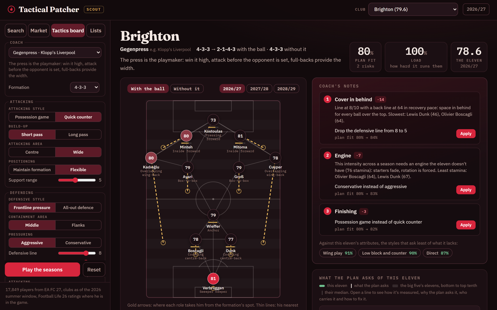
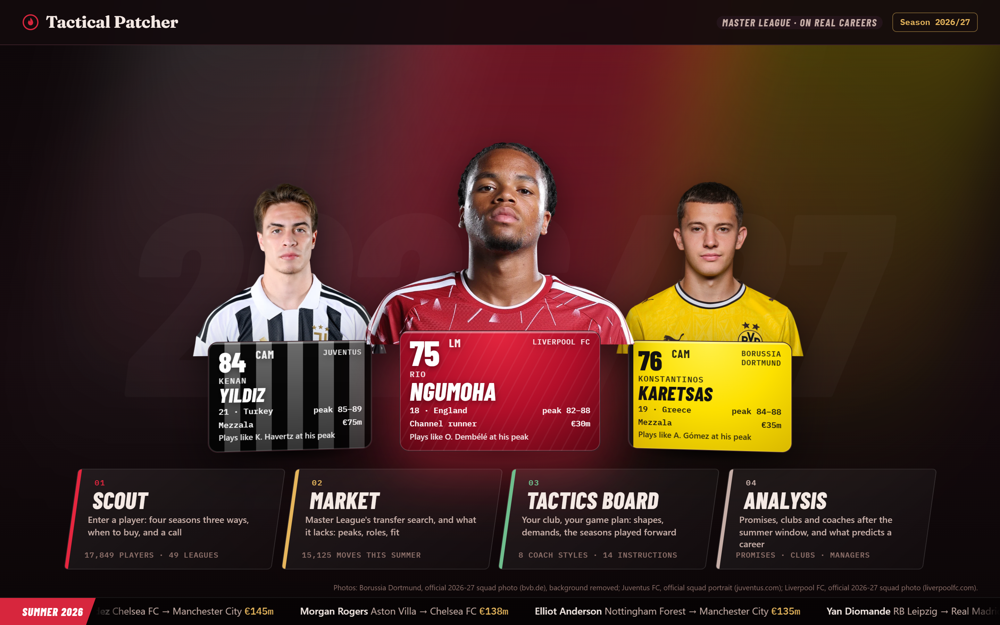
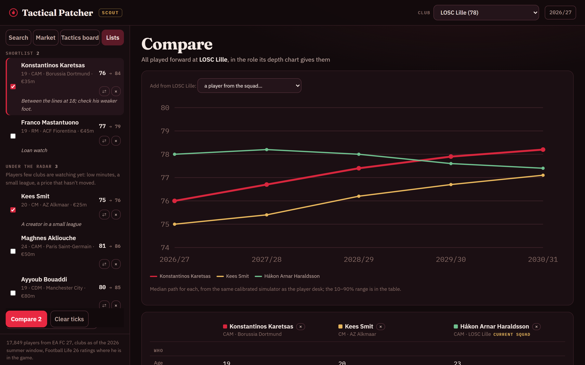
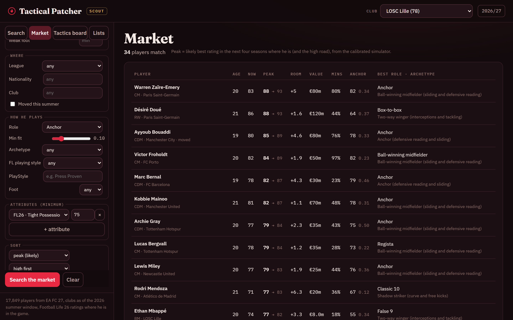
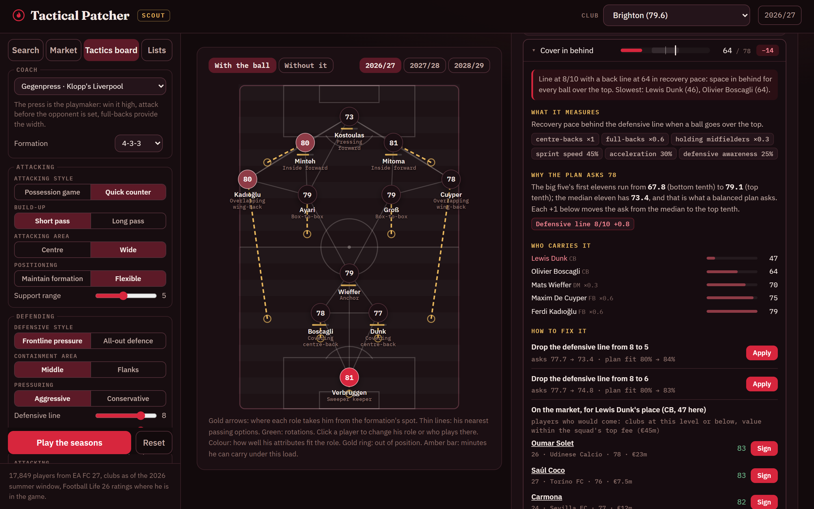
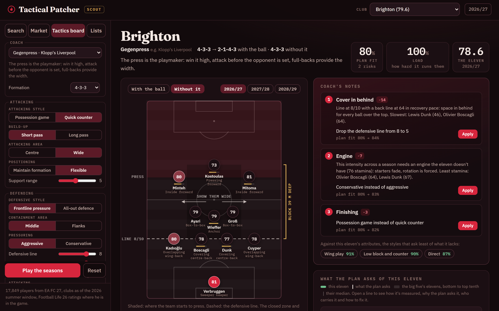
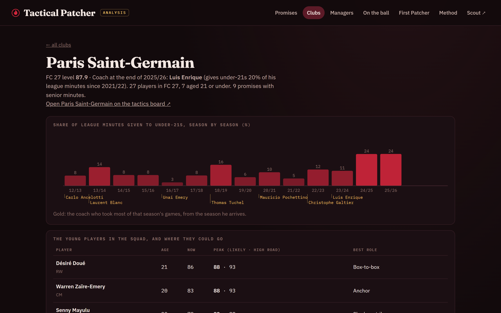

# Tactical Patcher

**Master League, on real careers.**

Every Master League save has the same moment: the 17-year-old bought for
nothing is 80 by his third season, because the game decided it the day he
was generated. Real football doesn't work like that. Some youngsters
explode, many stall, and what decides it is minutes, the level around them,
the club and the coach.

The Tactical Patcher is what a Master League manager would want if the
game took real careers seriously: a scout's desk, a market, a tactics board
and the analysis behind them, built on EA FC 27, Football Life 26's own
database and the summer 2026 transfer window.



## What's in it

**Home.** A title screen in the spirit of a Football Simulation Game Menu: three featured
players, each standing on his card in his club's kit (Yıldız for Juventus,
Ngumoha for Liverpool, Karetsas for Dortmund), the menu, and the summer
window's biggest fees running along the bottom.



**Scout desk.** Search any of 17,849 current players and pick your club.
His card (club as of the 2026 summer window, value, last season's minutes,
EA FC 27 and Football Life 26 profiles), the roles he fits and the level
he'd bring to each, four seasons three ways (stays, joins you in the role
your depth chart gives him, a season as a starter on loan), when to buy,
a call with its reasons, the players who play like him today and among the
decade's elite peaks, and the ones who looked like him at his age.

**Lists and comparison.** A shortlist and a list for the players under the
radar, each with notes, kept between sessions. Tick two to four players and
compare them side by side, every one played forward at your club in the
role its depth chart gives him, or set a scouted player against one of your
own: rating now and in two seasons, likely peak and high road, the range in
four seasons, value, minutes, roles, archetype and attributes, the best of
the group on each line marked.



**Market.** Master League's transfer search, then what it lacks: peak on
the likely and the high road, growth room, peak per million, level in a
chosen role and attribute fit to it, archetype, Football Life playing
style, PlayStyles, any attribute minimum.



**Tactics board.** Your club and a game plan written the way PES writes
one: attacking and defensive style, build-up, attacking area, containment,
pressuring, defensive line, compactness, support range, two advanced
instructions per phase (false full-backs, tiki-taka, gegenpress, deep
defensive line...), or one of eight coach styles that sets all of it. Click
a player to change his role or who plays there. The board shows:
- both phases on the pitch: where each role goes with the ball and the
  shape that makes (a 4-3-3 with inverted full-backs attacks as a 2-3-5),
  the passing network, rotations, the long ball; without it, the block,
  its line, its depth in metres, where it presses and where it shows the
  opponent;
- what the plan asks of this eleven against what its attributes give
  (press resistance for a short build-up, recovery pace for a high line,
  an engine for gegenpressing), and where it breaks, by name;
- the seasons played forward: the plan's load caps the minutes each
  starter can carry, minutes decide growth, the coach picks again from the
  grown squad.

It coaches as well. The coach's notes put the three changes that help
most at the top, each one click from applied, and name the coach styles
this eleven suits best. Every demand opens up: what it measures (which
positions, which attributes, with their weights), why the plan asks what
it asks (the big five's spread and how far each of your instructions
pushes it), who carries it player by player, and how to fix it: a
tactical change with its side effects, a player from your own squad, or
targets on the market who would really come.





**Analysis.** The data behind the app, read as a scout would:
- *Promises:* every under-21 with senior minutes, scored on the chance of
  becoming a top-flight regular by 23–26, at his club after the summer
  2026 window;
- *Clubs:* each club of nine leagues with its FC 27 level, the share of
  minutes it gives under-21s season by season and under which coach, its
  young players and where they could go, the window's arrivals and
  departures;
- *Managers:* every coach with 30+ league games since 2021/22, how much of
  his minutes went to under-21s and the youngsters he relied on; and, for
  the older cohorts, whether the youngsters he trusted stayed regulars;
- *On the ball:* every action of 2017/18 in the big five valued with VAEP,
  the young players whose actions were worth most, and what became of them;
- *First Patcher:* the season engine on real FIFA 23 squads, set against
  what clubs really did with their under-21s.



More in [screenshots/](screenshots/).

## Under the hood

- **Football Life 26, understood from the game's own files.** CRI CPK
  archives and their @UTF tables, 312-byte player records, 25 abilities as
  6-bit fields packed five to a word; every field label checked three ways
  (against EA FC 27, PES 2021's database and the game's own Master League
  records). Eight database snapshots, 29,413 players. Saved Master League
  careers, read without changing a byte, measure how the game itself grows
  players.
- **One key per player** across EA FC 26/27, FIFA 15–23, Football Life 26
  and Transfermarkt: Fellegi–Sunter record linkage with m/u weights fitted
  by EM (name tokens, birth date or year, height, foot, nation, club, line,
  rating consistency), chained through Transfermarkt's exact birth dates.
  82,933 people.
- **Growth engine.** LightGBM quantile regression (P10, P50, P90 of next
  season's change) on season-to-season changes from FIFA 15–23, each joined
  to the minutes the player really got. Missing minutes stay missing.
- **Four-season simulator.** Learned minutes and club-move models,
  heavy-tailed draws, a spread per talent tier calibrated on a time machine
  (FIFA 18 → 22) and tested on another (FIFA 19 → 23).
- **Profiles.** 28 roles as attribute signatures, fit read on shape
  (attributes relative to level), archetypes from Gaussian mixtures sized
  by BIC, plays-like by cosine similarity of shapes.
- **When to buy.** A market value model (LightGBM, R² 0.77 in log on unseen
  seasons) and least-squares Monte Carlo (Longstaff–Schwartz) over 300
  futures: buying is an option you can exercise in any window.
- **Tactics layer.** A game plan read as football rules: role movements in
  and out of possession, shapes, and nine demands (build-up under pressure,
  chance creation, width and delivery, finishing, transition speed,
  pressing power, cover in behind, box defending, engine) set on the
  spread of the big five's elevens: a neutral plan asks what the median
  eleven has, an extreme one what only the top tenth have. These are rules
  written from football knowledge, labelled as rules in the app; the growth
  they feed is learned.
- **Real club names.** EA has placeholders where it lacks a licence
  (Lombardia FC is Inter, Milano FC is AC Milan, Bergamo Calcio is
  Atalanta) and short forms elsewhere. Each Transfermarkt club votes for the
  EA team most of its own players are registered at; 200 EA names take the
  real one.
- **Realism audit** (`python -m patcher.audit`): the whole app played on
  cases a football person can judge at a glance. Prospects grow, stars
  plateau, veterans decline (measured against what real careers did),
  calls agree with prices, every coach style ranks an elite eleven above a
  mid-table one above a weak one, every instruction moves its own demand
  the right way, every shape has ten outfield players. 41 checks.
- **Promise model.** Penalised logistic regression on 7,507 player states
  (born 1995–99, at 18 to 21), outcome at 23–26, tested on a birth year it
  never saw; ranges from the 25 nearest comparables at the same age and
  position, PECOTA-style.
- **Model lab.** LightGBM, CatBoost, an MLP ensemble and a GRU on rating
  sequences, compared on pinball loss for an unseen season, blend weights
  chosen on a separate validation season. The MLP–LightGBM blend beats
  LightGBM alone by 0.9 % and its 80 % band holds 80 % of real changes
  (76 % for LightGBM).
- FastAPI, DuckDB, pandas; a vanilla JS front end.

## What the data says

- **Master League is on rails.** In real saves, almost every 16–20 year-old
  gains 5+ in two seasons; real careers split, some explode, many stall.
  ML also declines players from 27; real ratings barely move until 30.
- **A rating follows the club too.** Kees Smit, starting at AZ, moves from
  75.0 to 75.6 in four seasons on EA's scale; on Bayern's bench he reaches
  81.2, as a Bayern starter 84.5. A rating is partly the club's.
- **Where youth internationals land.** UEFA cohorts to 2017 becoming
  big-five regulars: France 29 %, Spain 27 %, Italy 21 %, England 16 %,
  Germany 14 %, Netherlands 9 % (45 % regulars, mostly at home).
- **Giving youth minutes and keeping youngsters run in opposite
  directions.** Managers who give under-21s the most minutes graduate the
  smallest share of them (correlation −0.42): volume developers and
  selective developers.
- **A club's minutes reveal its manager.** Ligue 1, 2022/23–2024/25,
  revealed youth trust: Strasbourg 12, Montpellier 10, Lyon 6, Monaco 2,
  PSG 0.

The full story is in the [devlog](DEVLOG.md).

## Is it any good

Every model is judged on players it never saw: trained on four birth
years, tested on the fifth.

| | 18 | 19 | 20 | 21 |
|---|---|---|---|---|
| Becomes a top-flight regular (AUC) | 0.72 | 0.77 | 0.79 | 0.83 |
| Becomes a big-five regular (AUC) | 0.80 | 0.85 | 0.85 | 0.88 |
| Real minutes inside the comparables' range | 86 % | 87 % | 86 % | 85 % |

Growth engine, one season ahead on a season it never saw: mean absolute
error 1.42 rating points, 1.77 for under-21s (age average: 1.60 and 2.06).

Four-season simulator, started from FIFA 19 with only what was known then
and compared with FIFA 23: 80 / 78 / 76 / 76 % of real ratings inside its
band, by talent tier (under 65, 65–71, 72–77, 78+), against 31–40 % for a
simulator that keeps each player in his starting role.

## What comes next

The Patcher reads players through ratings, because that is what a Master
League save has. A club has more: what a player does on match day and on a
Tuesday morning in training. That is the next project, Promesse.

## Data

| Source | Licence |
|---|---|
| [transfermarkt-datasets](https://github.com/dcaribou/transfermarkt-datasets): players, appearances, managers, values, transfers (2012–2026) | CC0 |
| FIFA 15–23 career-mode ratings ([Hugging Face mirror](https://huggingface.co/datasets/jsulz/FIFA23), scraped from sofifa) | MIT (mirror) |
| FIFA 15–23 every weekly update (same mirror) | train only, not redistributed |
| EA SPORTS FC 27 and FC 26 ratings (EA's ratings site) | train only, not redistributed |
| Transfermarkt pages, 2026 summer window (64 leagues) | private research cache |
| Wikipedia: youth tournament squads, player pages | CC BY-SA 4.0 |
| SP Football Life 26 database and Master League saves | read from a local install, never copied |
| [Wyscout public events](https://doi.org/10.6084/m9.figshare.c.4415000), Pappalardo et al., *Scientific Data* 6, 236 (2019) | CC BY 4.0 |

**Not in this repo:** game files, saves, ratings, scraped pages and
trained models, nor the reader for Master League saves. The code reads
everything else from your own copies under `PATCHER_DATA`, where the
scouting lists are kept too. The home screen's player photos are the clubs' official squad
photos, kept in the data folder and credited on the page; FotMob's
portraits stand in when they're missing.

## Run

Point `PATCHER_DATA` at the folder holding your own copies of the sources
(default: `./data`).

```bash
uv venv && uv pip install -r requirements.txt
python -m patcher.ingest          # warehouse + crosswalks
python -m patcher.features        # player states
python -m patcher.model           # promise model
python -m patcher.growth          # first growth engine
python -m patcher.first_patcher   # revealed youth trust, Ligue 1
python -m patcher.actions         # VAEP on Wyscout events (long)
python -m patcher.sources.ea      # EA FC 27 / FC 26 ratings
python -m patcher.sources.transfermarkt 2026
python -m patcher.sources.fl      # Football Life 26 database (local install)
python -m patcher.resolve         # one key per player (probabilistic linkage)
python -m patcher.growth2         # growth engine
python -m patcher.rollout         # minutes and club-move models
python -m patcher.backtest v2     # time machine: spread per talent tier
python -m patcher.market          # market value model
python -m patcher.scout           # the scout desk's tables
python -m patcher.names           # real club names for EA's placeholders
python -m patcher.profile         # roles, archetypes, plays-like
python -m patcher.scout market    # every player played forward, for the market search
python -m patcher.squad           # the tactics board's demands, set on the big five's elevens
python -m patcher.youth           # youth tournaments and what they became
python -m patcher.audit           # does it behave like football?
uvicorn patcher.api:app --port 8790   # / home, /scout the app, /analysis the analysis pages
```

## Licence

All rights reserved (see `LICENSE`): the code is here to be read, not reused
without permission.
